# 基于文学创作的社交论坛--论文

> 🎓 **计算机毕业设计 · 基于文学创作的社交论坛--论文**
>
> 本仓库只放**项目介绍 + 运行截图**（截图是站点带水印的原图，存在仓库 `images/` 里）。
>
> 👉 **完整可运行源码 / 数据库脚本 / 部署文档：[点我获取](https://geekcode.top/archives/%E5%9F%BA%E4%BA%8E%E6%96%87%E5%AD%A6%E5%88%9B%E4%BD%9C%E7%9A%84%E7%A4%BE%E4%BA%A4%E8%AE%BA%E5%9D%9B-%E8%AE%BA%E6%96%87?utm_source=github)**
>
> 💬 咨询微信：**ir9372**　|　🌐 更多项目：[极客代码 geekcode.top](https://geekcode.top/?utm_source=github)
>
> 📌 项目详情页：<https://geekcode.top/archives/%E5%9F%BA%E4%BA%8E%E6%96%87%E5%AD%A6%E5%88%9B%E4%BD%9C%E7%9A%84%E7%A4%BE%E4%BA%A4%E8%AE%BA%E5%9D%9B-%E8%AE%BA%E6%96%87?utm_source=github>

<table><td width="230" align="center"> <b>扫码加微信 ir9372</b></td><td valign="middle">📦 源码 = 项目介绍 + 全部运行截图 + 数据库 + 部署文档 👉 点上方任意截图，直接跳到 <b>极客代码 geekcode.top</b> 详情页</td></table>

---

<h1>基于文学创作的社交论坛--论文</h1>
<h2>项目概述</h2>

本项目“基于文学创作的社交论坛”旨在构建一个集文学内容发布、互动交流与系统管理于一体的综合性Web平台。项目核心目标是解决传统文学社区信息分散、互动性弱及管理效率低下的问题，为文学爱好者提供便捷的创作展示空间，同时为管理员提供高效的内容审核与用户管理工具。

适用场景主要面向高校校园文学社团、在线写作社区及小型文化类资讯网站。目标用户群体包括普通注册用户（读者/作者）和系统管理员。技术架构采用前后端分离模式，后端基于 Spring Boot 框架结合 MyBatis-Plus 实现数据持久化与安全控制，前端通过 Vue 集成开发，确保界面交互流畅且易于维护。该项目不仅具备基础的文章浏览与评论功能，还强化了举报机制与警告信息管理，体现了对社区内容合规性的重视。

<h2>技术架构</h2>
<h3>总体架构设计</h3>

本项目采用典型的 B/S 架构，遵循前后端分离的开发模式。整体结构分为表现层、业务逻辑层、数据访问层和数据库层。

<a href="https://geekcode.top/archives/%E5%9F%BA%E4%BA%8E%E6%96%87%E5%AD%A6%E5%88%9B%E4%BD%9C%E7%9A%84%E7%A4%BE%E4%BA%A4%E8%AE%BA%E5%9D%9B-%E8%AE%BA%E6%96%87?utm_source=github" title="查看完整源码">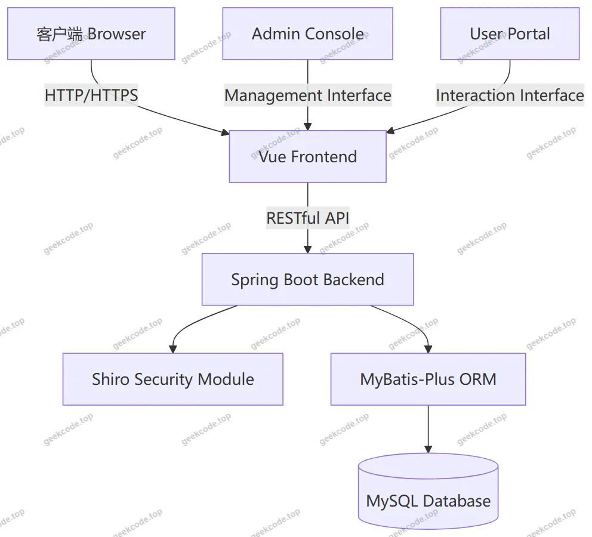</a>

<h3>核心技术选型理由</h3>
<ol>
<li><strong>后端框架</strong>：选用 <strong>Spring Boot</strong> 作为核心容器，利用其自动配置特性快速搭建应用骨架，简化部署流程。<strong>spring-boot-starter-web</strong> 提供了基础的 Web 服务能力。</li>
<li><strong>安全认证</strong>：引入 <strong>Apache Shiro</strong> (<code>shiro-spring</code>) 进行权限管理与身份认证。相比 Spring Security，Shiro 更轻量且易于集成，适合本项目的中小型规模，能够有效保护后台管理接口及敏感操作。</li>
<li><strong>数据持久层</strong>：使用 <strong>MyBatis-Plus</strong> 配合 <code>mybatis-spring-boot-starter</code>。MyBatis-Plus 在保留 MyBatis 灵活 SQL 编写能力的同时，提供了通用的 CRUD 方法，显著减少了样板代码，提升了开发效率。</li>
<li><strong>数据库</strong>：采用 <strong>MySQL</strong> (<code>mysql-connector-java</code>) 作为关系型数据库，存储文章、用户、公告等结构化数据。</li>
<li><strong>辅助组件</strong>：使用 <code>commons-lang3</code> 处理通用字符串与对象操作，<code>validation-api</code> 用于参数校验，确保输入数据的合法性；<code>protobuf-java</code> 可能用于特定模块的数据序列化或通信优化。</li>
</ol>
<h3>数据库设计要点</h3>

根据控制器列表推断，数据库主要包含以下核心实体表：

<ul>
<li><strong>用户表 (Users)</strong>：存储注册用户基本信息及角色标识。</li>
<li><strong>文章信息表 (Wenzhangxinxi)</strong>：存储文学作品的标题、内容、类型及发布时间。</li>
<li><strong>文章类型表 (Wenzhangleixing)</strong>：定义文章的分类标签（如诗歌、散文、小说等）。</li>
<li><strong>评论表 (Discusswenzhangxinxi)</strong>：记录用户对文章的评论内容及关联ID。</li>
<li><strong>举报表 (Wenzhangjubao)</strong>：存储用户提交的违规内容举报信息。</li>
<li><strong>警告信息表 (Jinggaoxinxi)</strong>：记录系统对违规用户的警告状态。</li>
<li><strong>聊天表 (Chat)</strong>：支持用户间的即时通讯或留言功能。</li>
<li><strong>系统公告/新闻表 (News/Systemintro)</strong>：存储平台发布的官方通知及简介。</li>
<li><strong>配置表 (Config)</strong>：存储系统全局配置参数。</li>
</ul>
<h2>功能模块</h2>
<h3>前台用户端功能</h3>

前台页面主要服务于普通用户，侧重于内容消费与互动参与。

<ol>
<li><strong>首页展示</strong></li>
</ol>
<ul>
<li>展示最新推荐的文章列表、热门话题及系统公告摘要，引导用户进入具体内容页。</li>
</ul>
<ol start="2">
<li><strong>文章信息模块</strong></li>
</ol>
<ul>
<li><strong>文章浏览</strong>：以列表形式展示所有公开文章，支持按类型筛选。</li>
<li><strong>详情查看</strong>：点击文章可查看详情内容及评论区。</li>
<li><strong>文章评论</strong>：用户可在文章详情页发表看法，形成讨论氛围。</li>
</ul>
<ol start="3">
<li><strong>个人中心模块</strong></li>
</ol>
<ul>
<li><strong>我的文章</strong>：查看和管理自己发布的文学作品。</li>
<li><strong>我的收藏</strong>：查看已收藏的文章列表（对应截图中的收藏列表功能）。</li>
<li><strong>消息中心</strong>：接收系统警告信息及聊天消息。</li>
</ul>
<ol start="4">
<li><strong>互动与反馈模块</strong></li>
</ol>
<ul>
<li><strong>文章举报</strong>：发现违规内容时，用户可提交举报申请，填写举报理由（对应截图中的文章举报列表）。</li>
<li><strong>聊天交流</strong>：提供用户间或用户与管理者的沟通渠道（对应 ChatController）。</li>
</ul>
<ol start="5">
<li><strong>系统公告模块</strong></li>
</ol>
<ul>
<li>查看平台发布的新闻、活动通知及关于我们的介绍信息。</li>
</ul>
<h3>后台管理端功能</h3>

后台页面服务于管理员，侧重于内容审核、用户管理及系统维护。

<ol>
<li><strong>登录与安全</strong></li>
</ol>
<ul>
<li>管理员专属登录入口，通过 Shiro 进行身份验证。</li>
</ul>
<ol start="2">
<li><strong>文章管理</strong></li>
</ol>
<ul>
<li><strong>文章信息审核</strong>：查看所有用户发布的文章，执行编辑、删除或下架操作。</li>
<li><strong>文章类型管理</strong>：增删改查文章分类标签，规范内容归类。</li>
</ul>
<ol start="3">
<li><strong>用户管理</strong></li>
</ol>
<ul>
<li><strong>用户列表</strong>：查看注册用户的详细信息、注册时间及状态。</li>
<li><strong>权限控制</strong>：管理用户账号的启用与禁用。</li>
</ul>
<ol start="4">
<li><strong>内容监管</strong></li>
</ol>
<ul>
<li><strong>举报处理</strong>：查看用户提交的文章举报列表，核实后对被举报文章进行处理或对举报人反馈。</li>
<li><strong>警告管理</strong>：查看并管理系统发出的警告信息列表，记录违规处罚历史。</li>
<li><strong>评论管理</strong>：审核文章下方的用户评论，清理恶意言论。</li>
</ul>
<ol start="5">
<li><strong>系统设置</strong></li>
</ol>
<ul>
<li><strong>系统公告/新闻发布</strong>：编辑并发布首页显示的新闻和公告。</li>
<li><strong>关于我们</strong>：维护平台简介页面内容。</li>
<li><strong>系统配置</strong>：修改站点名称、Logo及其他全局参数。</li>
<li><strong>聊天监控</strong>：查看聊天记录，必要时介入处理纠纷。</li>
</ul>
<h2>用户角色与权限</h2>

本项目主要涉及两种核心角色：<strong>普通用户</strong> 和 <strong>系统管理员</strong>。

<h3>1. 普通用户 (Registered User)</h3>
<ul>
<li><strong>访问范围</strong>：仅限前台界面。</li>
<li><strong>具体权限</strong>：</li>
<li><strong>浏览权限</strong>：可查看首页、文章列表、系统公告、关于我们等信息。</li>
<li><strong>创作权限</strong>：可发布新文章，选择文章类型。</li>
<li><strong>互动权限</strong>：可对文章进行评论、收藏；可通过聊天模块与其他用户交流。</li>
<li><strong>监督权限</strong>：可对违规文章发起举报。</li>
<li><strong>个人管理</strong>：可查看自己的文章、收藏列表及收到的警告信息。</li>
<li><strong>限制</strong>：无法访问后台路由，无法删除他人文章，无法修改系统配置。</li>
</ul>
<h3>2. 系统管理员 (Administrator)</h3>
<ul>
<li><strong>访问范围</strong>：后台管理界面及部分高级前台功能。</li>
<li><strong>具体权限</strong>：</li>
<li><strong>全量数据管理</strong>：拥有对所有文章、评论、用户信息的增删改查权限。</li>
<li><strong>内容审核权</strong>：负责处理文章举报，决定被举报内容的去留；管理文章类型分类体系。</li>
<li><strong>用户监管权</strong>：查看用户列表，对违规用户发出警告或封禁账号；监控聊天内容。</li>
<li><strong>系统运营权</strong>：发布和管理系统公告、新闻、关于我们页面；修改系统基础配置。</li>
<li><strong>安全权限</strong>：通过 Shiro 框架获得最高权限，绕过普通用户的数据隔离限制。</li>
</ul>

<em>(注：根据现有代码上下文，未明确提及“教师”、“学生”等细分角色，故仅列出上述两类基本角色。)</em>

<h2>项目特色与创新点</h2>
<ol>
<li>
<strong>闭环的内容合规管理体系</strong>
   项目不仅仅是一个简单的博客系统，而是构建了“发布 -&gt; 举报 -&gt; 审核 -&gt; 警告”的完整闭环。通过 <code>Wenzhangjubao</code>（文章举报）和 <code>Jinggaoxinxi</code>（警告信息）模块的结合，实现了用户监督与系统管控的双向互动，有效净化了文学社区的创作环境。

</li>
<li>
<strong>精细化的社交互动功能</strong>
   引入了 <code>Chat</code>（聊天）模块，突破了传统论坛仅限于评论区的单向或异步交流模式，支持更实时的社交连接，增强了用户粘性。同时，收藏功能 (<code>Storeup</code>) 帮助用户沉淀优质内容，提升阅读体验。

</li>
<li>
<strong>轻量级高可用的技术栈组合</strong>
   采用 Spring Boot + MyBatis-Plus + Shiro 的经典组合，在保证企业级应用稳定性的同时，极大降低了系统的复杂度与维护成本。MyBatis-Plus 的代码生成器特性使得后台管理功能的快速迭代成为可能，适合毕业设计周期内的敏捷开发需求。

</li>
<li>
<strong>模块化清晰的前后台分离</strong>
   虽然前端集成在一起，但路由规划上严格区分了 <code>/news</code>, <code>/aboutus</code> 等公共内容与 <code>/config</code>, <code>/yonghu</code> 等管理路径，配合 Shiro 拦截器，实现了清晰的权限边界，保障了后台数据的安全性。

</li>
</ol>
<h2>部署环境</h2>

为确保项目正常运行，需准备以下软件环境：

<ol>
<li><strong>操作系统</strong>：Windows 10/11, macOS, 或 Linux (CentOS/Ubuntu)。</li>
<li><strong>Java 运行环境</strong>：</li>
</ol>
<ul>
<li>JDK 版本：建议 JDK 8 或 JDK 11（兼容 Spring Boot 2.x 系列）。</li>
</ul>
<ol start="3">
<li><strong>数据库服务</strong>：</li>
</ol>
<ul>
<li>MySQL Server：版本 5.7 或 8.0。</li>
<li>需创建对应的数据库实例，并导入项目提供的 <code>.sql</code> 初始化脚本。</li>
</ul>
<ol start="4">
<li><strong>构建工具</strong>：</li>
</ol>
<ul>
<li>Maven：用于后端依赖管理和项目打包。</li>
<li>Node.js &amp; npm/yarn：如果前端需要独立编译或安装依赖（视具体 vue-integrated 打包方式而定，通常需 Node 环境支持 Vue CLI 或 Vite）。</li>
</ul>
<ol start="5">
<li><strong>浏览器</strong>：</li>
</ol>
<ul>
<li>Chrome, Edge, Firefox 等现代主流浏览器，建议使用最新版本以获得最佳兼容性。</li>
</ul>
<ol start="6">
<li><strong>其他</strong>：</li>
</ol>
<ul>
<li>IDE：IntelliJ IDEA 或 Eclipse（用于后端开发与调试）。</li>
<li>文本编辑器：VS Code（用于前端 Vue 文件编辑）。</li>
</ul>
<h2>五、技术特性</h2>
<ul>
<li>前后端集成部署，前端资源打包至后端 static 目录</li>
<li>使用 MyBatis-Plus 简化数据访问层开发</li>
<li>集成 Shiro 权限框架实现角色权限控制</li>
</ul>
<h2>六、功能模块截图</h2>
<h3>前台用户端</h3>
<h4>前台-警告信息列表</h4>

<a href="https://geekcode.top/archives/%E5%9F%BA%E4%BA%8E%E6%96%87%E5%AD%A6%E5%88%9B%E4%BD%9C%E7%9A%84%E7%A4%BE%E4%BA%A4%E8%AE%BA%E5%9D%9B-%E8%AE%BA%E6%96%87?utm_source=github" title="查看完整源码">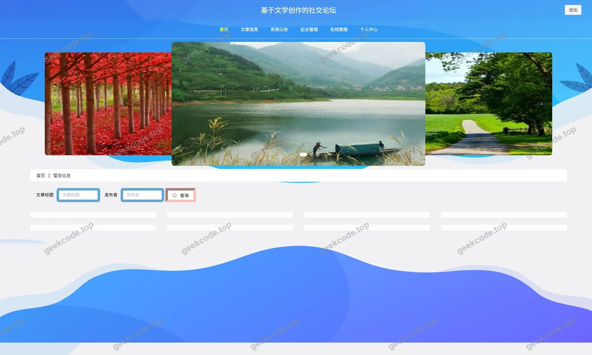</a>

<h4>前台-收藏列表</h4>

<a href="https://geekcode.top/archives/%E5%9F%BA%E4%BA%8E%E6%96%87%E5%AD%A6%E5%88%9B%E4%BD%9C%E7%9A%84%E7%A4%BE%E4%BA%A4%E8%AE%BA%E5%9D%9B-%E8%AE%BA%E6%96%87?utm_source=github" title="查看完整源码">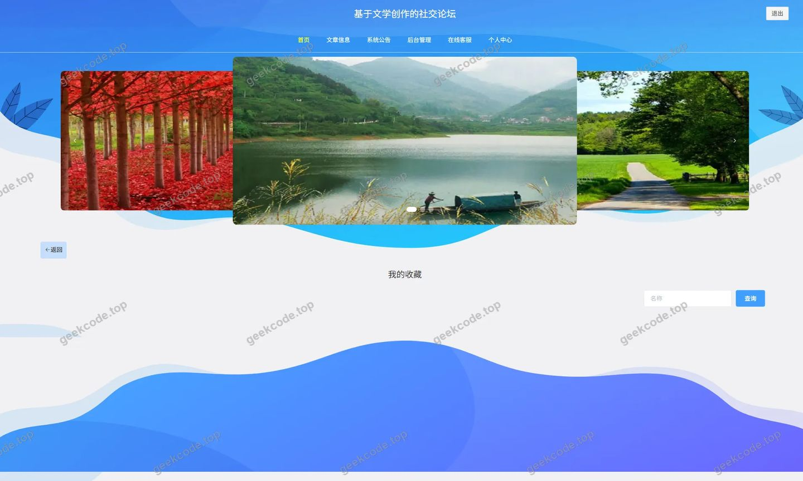</a>

<h4>前台-文章举报列表</h4>

<h4>前台-文章类型列表</h4>

<a href="https://geekcode.top/archives/%E5%9F%BA%E4%BA%8E%E6%96%87%E5%AD%A6%E5%88%9B%E4%BD%9C%E7%9A%84%E7%A4%BE%E4%BA%A4%E8%AE%BA%E5%9D%9B-%E8%AE%BA%E6%96%87?utm_source=github" title="查看完整源码">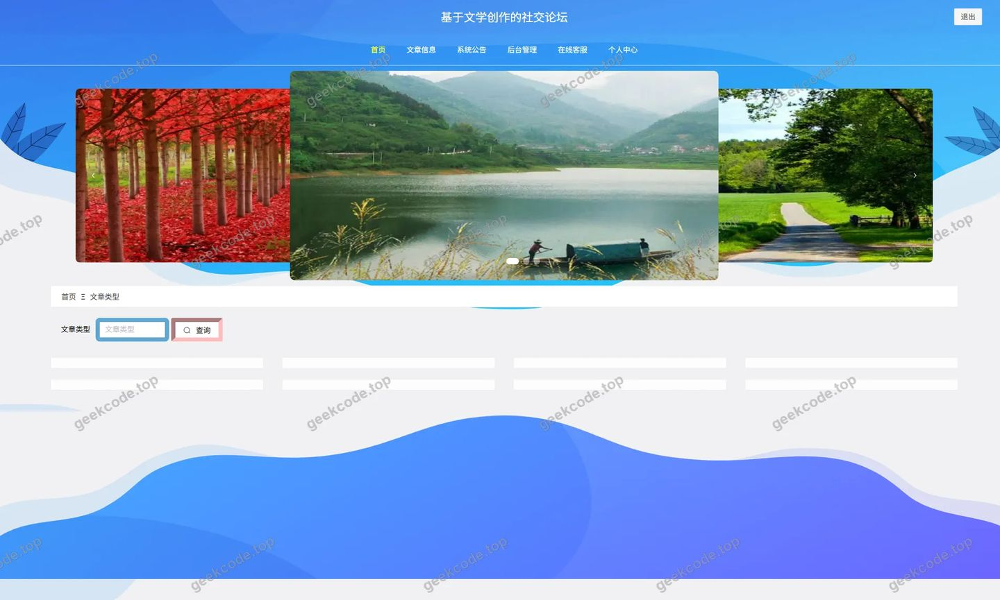</a>

<h4>前台-文章信息列表</h4>

<a href="https://geekcode.top/archives/%E5%9F%BA%E4%BA%8E%E6%96%87%E5%AD%A6%E5%88%9B%E4%BD%9C%E7%9A%84%E7%A4%BE%E4%BA%A4%E8%AE%BA%E5%9D%9B-%E8%AE%BA%E6%96%87?utm_source=github" title="查看完整源码">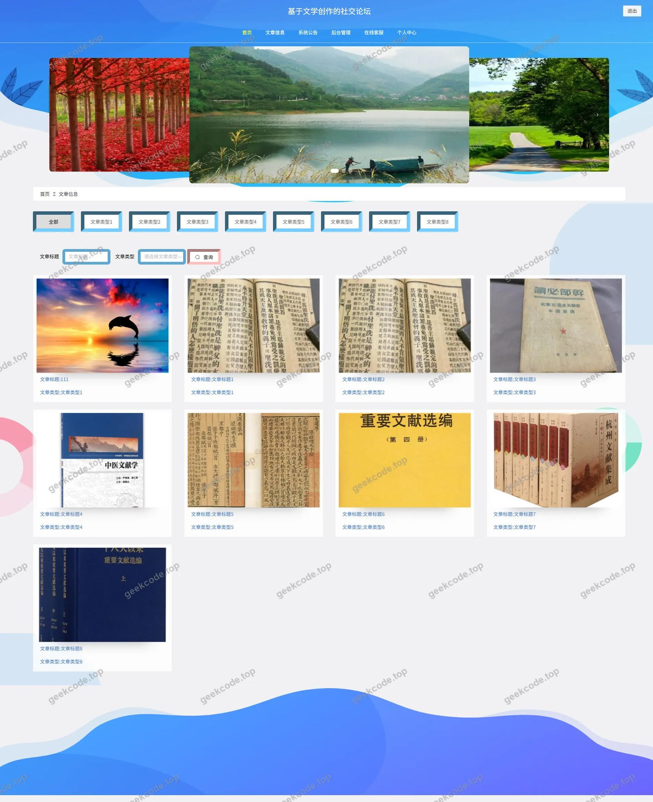</a>

<h4>前台-个人中心</h4>

<a href="https://geekcode.top/archives/%E5%9F%BA%E4%BA%8E%E6%96%87%E5%AD%A6%E5%88%9B%E4%BD%9C%E7%9A%84%E7%A4%BE%E4%BA%A4%E8%AE%BA%E5%9D%9B-%E8%AE%BA%E6%96%87?utm_source=github" title="查看完整源码">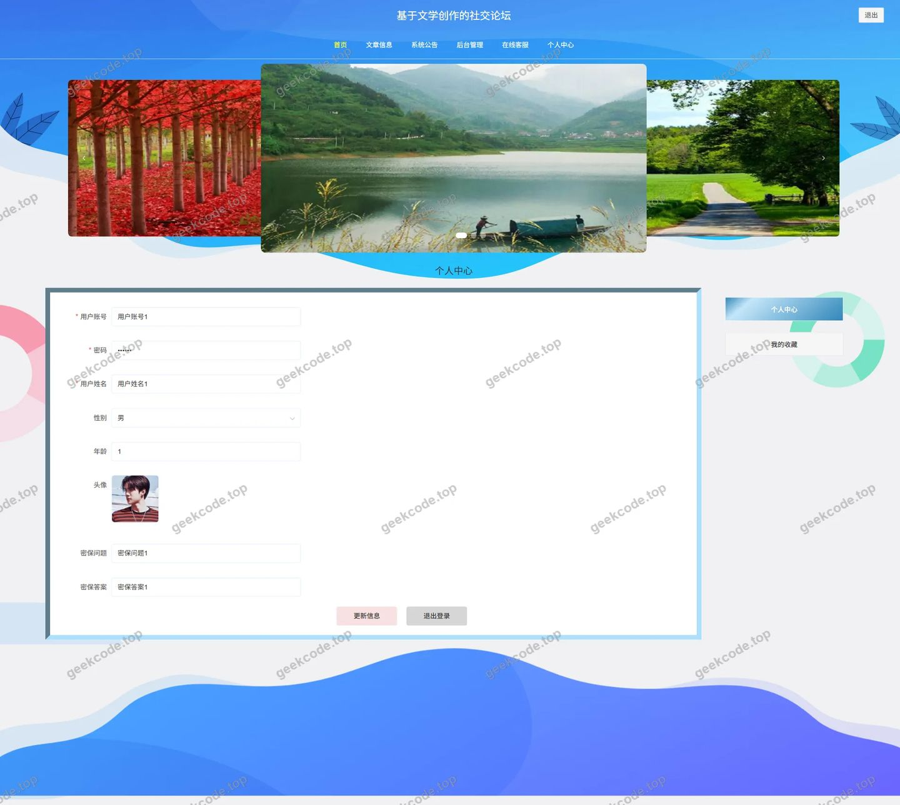</a>

<h4>前台-公告列表</h4>

<a href="https://geekcode.top/archives/%E5%9F%BA%E4%BA%8E%E6%96%87%E5%AD%A6%E5%88%9B%E4%BD%9C%E7%9A%84%E7%A4%BE%E4%BA%A4%E8%AE%BA%E5%9D%9B-%E8%AE%BA%E6%96%87?utm_source=github" title="查看完整源码">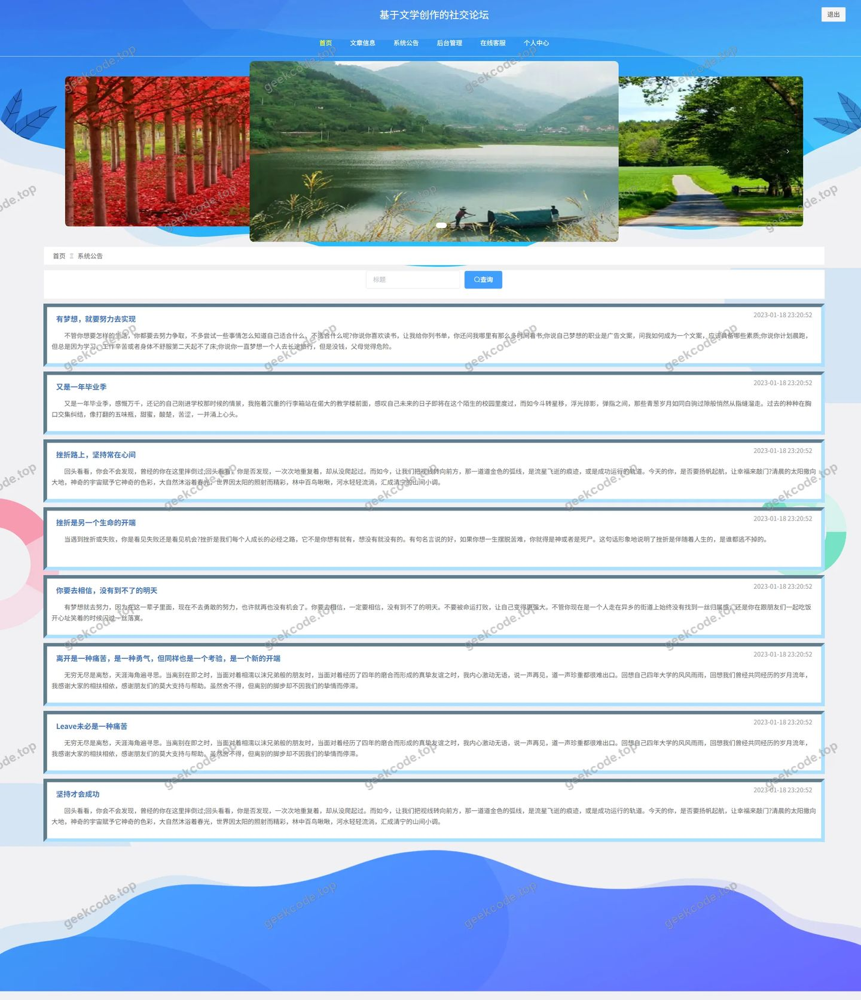</a>

<h3>后台管理端</h3>
<h4>后台-登录页</h4>

<a href="https://geekcode.top/archives/%E5%9F%BA%E4%BA%8E%E6%96%87%E5%AD%A6%E5%88%9B%E4%BD%9C%E7%9A%84%E7%A4%BE%E4%BA%A4%E8%AE%BA%E5%9D%9B-%E8%AE%BA%E6%96%87?utm_source=github" title="查看完整源码">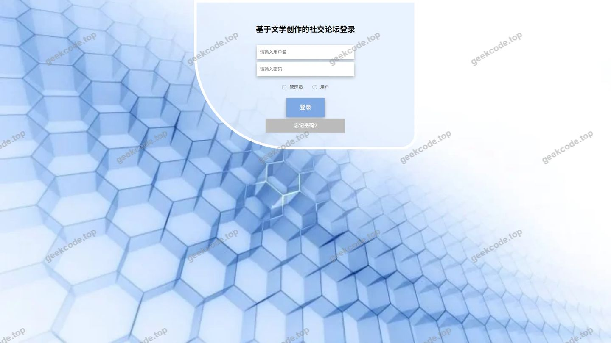</a>

<h4>后台-关于我们</h4>

<a href="https://geekcode.top/archives/%E5%9F%BA%E4%BA%8E%E6%96%87%E5%AD%A6%E5%88%9B%E4%BD%9C%E7%9A%84%E7%A4%BE%E4%BA%A4%E8%AE%BA%E5%9D%9B-%E8%AE%BA%E6%96%87?utm_source=github" title="查看完整源码">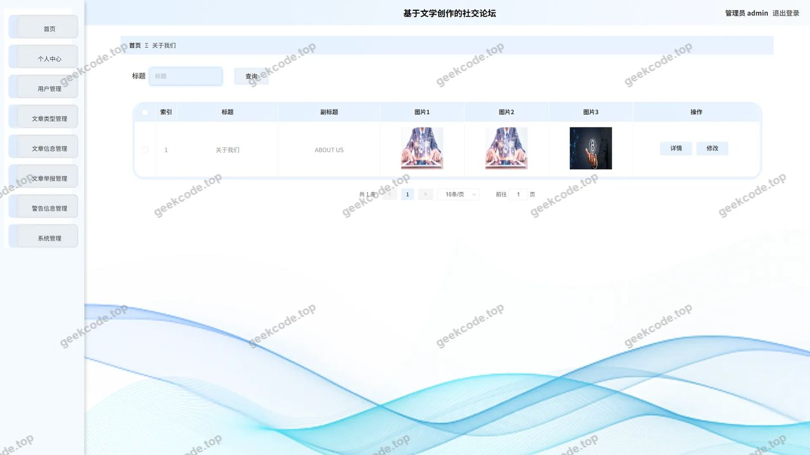</a>

<h4>后台首页</h4>

<a href="https://geekcode.top/archives/%E5%9F%BA%E4%BA%8E%E6%96%87%E5%AD%A6%E5%88%9B%E4%BD%9C%E7%9A%84%E7%A4%BE%E4%BA%A4%E8%AE%BA%E5%9D%9B-%E8%AE%BA%E6%96%87?utm_source=github" title="查看完整源码">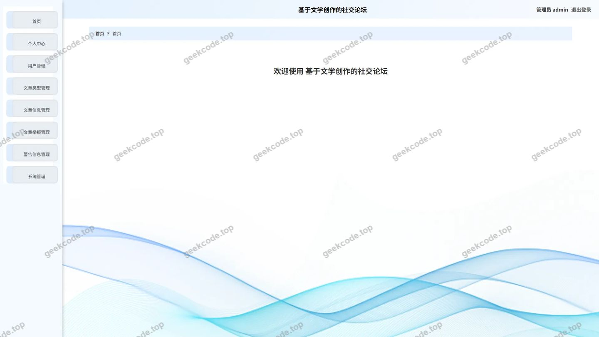</a>

<h4>后台-文章举报</h4>

<a href="https://geekcode.top/archives/%E5%9F%BA%E4%BA%8E%E6%96%87%E5%AD%A6%E5%88%9B%E4%BD%9C%E7%9A%84%E7%A4%BE%E4%BA%A4%E8%AE%BA%E5%9D%9B-%E8%AE%BA%E6%96%87?utm_source=github" title="查看完整源码">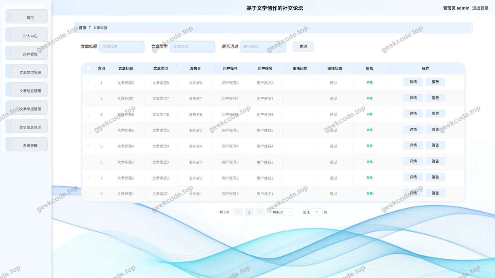</a>

<h4>后台-文章类型</h4>

<a href="https://geekcode.top/archives/%E5%9F%BA%E4%BA%8E%E6%96%87%E5%AD%A6%E5%88%9B%E4%BD%9C%E7%9A%84%E7%A4%BE%E4%BA%A4%E8%AE%BA%E5%9D%9B-%E8%AE%BA%E6%96%87?utm_source=github" title="查看完整源码">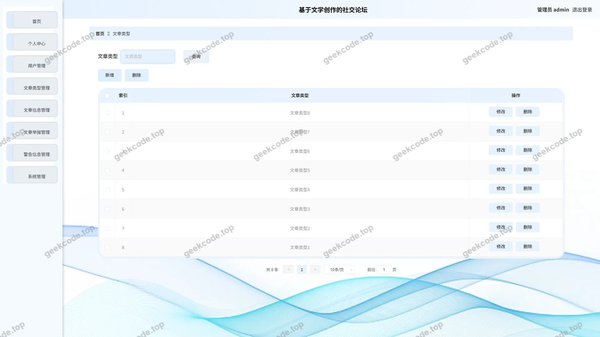</a>

<h4>后台-系统公告</h4>

<a href="https://geekcode.top/archives/%E5%9F%BA%E4%BA%8E%E6%96%87%E5%AD%A6%E5%88%9B%E4%BD%9C%E7%9A%84%E7%A4%BE%E4%BA%A4%E8%AE%BA%E5%9D%9B-%E8%AE%BA%E6%96%87?utm_source=github" title="查看完整源码">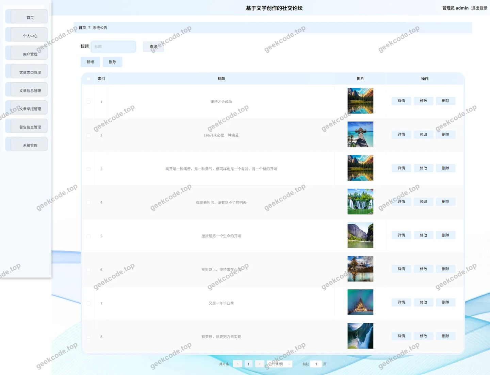</a>

<h4>后台-用户</h4>

<a href="https://geekcode.top/archives/%E5%9F%BA%E4%BA%8E%E6%96%87%E5%AD%A6%E5%88%9B%E4%BD%9C%E7%9A%84%E7%A4%BE%E4%BA%A4%E8%AE%BA%E5%9D%9B-%E8%AE%BA%E6%96%87?utm_source=github" title="查看完整源码">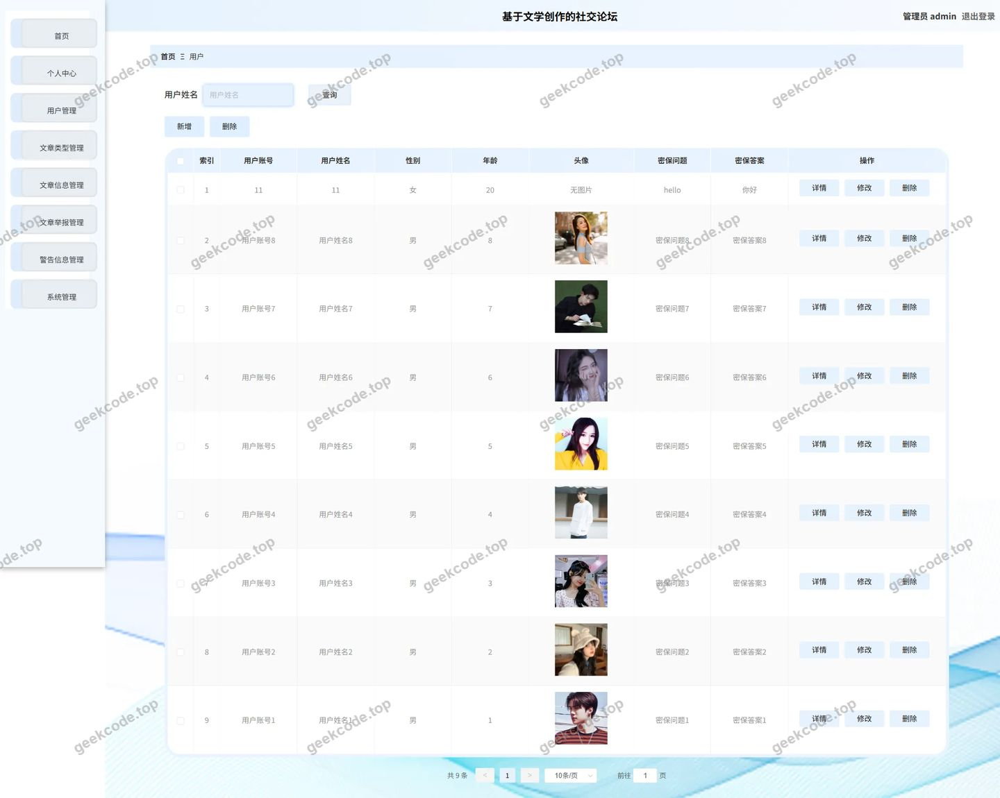</a>

<h4>后台-关于我们</h4>

<a href="https://geekcode.top/archives/%E5%9F%BA%E4%BA%8E%E6%96%87%E5%AD%A6%E5%88%9B%E4%BD%9C%E7%9A%84%E7%A4%BE%E4%BA%A4%E8%AE%BA%E5%9D%9B-%E8%AE%BA%E6%96%87?utm_source=github" title="查看完整源码">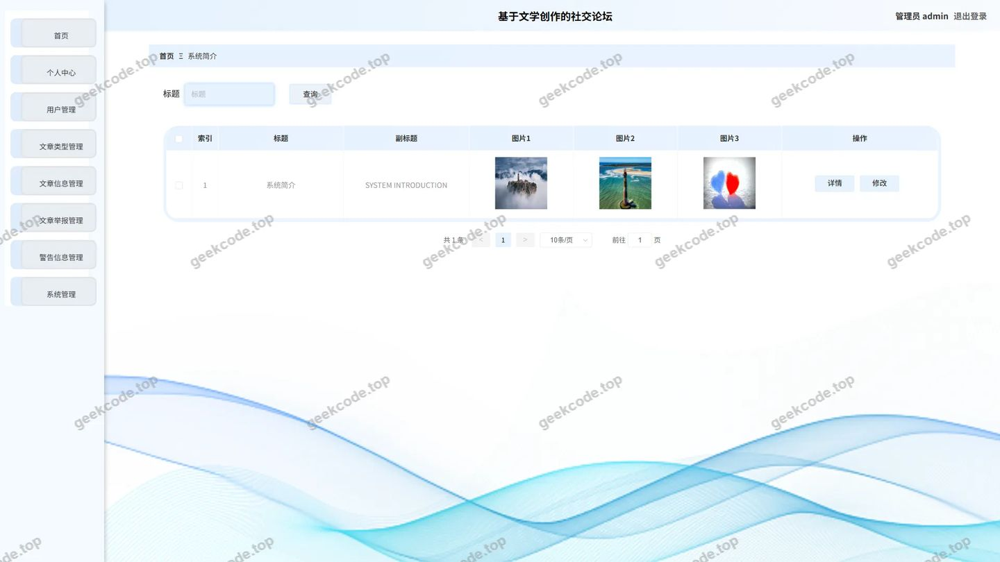</a>

---

## 获取完整源码

| 项目 | 说明 |
| --- | --- |
| 项目名 | 基于文学创作的社交论坛--论文 |
| 运行截图 | 本文 16 张（站点带水印原图，仓库 `images/` 目录） |
| 完整源码 | [https://geekcode.top/archives/%E5%9F%BA%E4%BA%8E%E6%96%87%E5%AD%A6%E5%88%9B%E4%BD%9C%E7%9A%84%E7%A4%BE%E4%BA%A4%E8%AE%BA%E5%9D%9B-%E8%AE%BA%E6%96%87?utm_source=github](https://geekcode.top/archives/%E5%9F%BA%E4%BA%8E%E6%96%87%E5%AD%A6%E5%88%9B%E4%BD%9C%E7%9A%84%E7%A4%BE%E4%BA%A4%E8%AE%BA%E5%9D%9B-%E8%AE%BA%E6%96%87?utm_source=github) |
| 咨询微信 | **ir9372**（备注：jingpin-yuanma） |
| 更多项目 | [极客代码 geekcode.top](https://geekcode.top/?utm_source=github) |

> 需要源码、部署、改配置、跑不起来等问题，加微信 ir9372 沟通，说明项目名即可。
